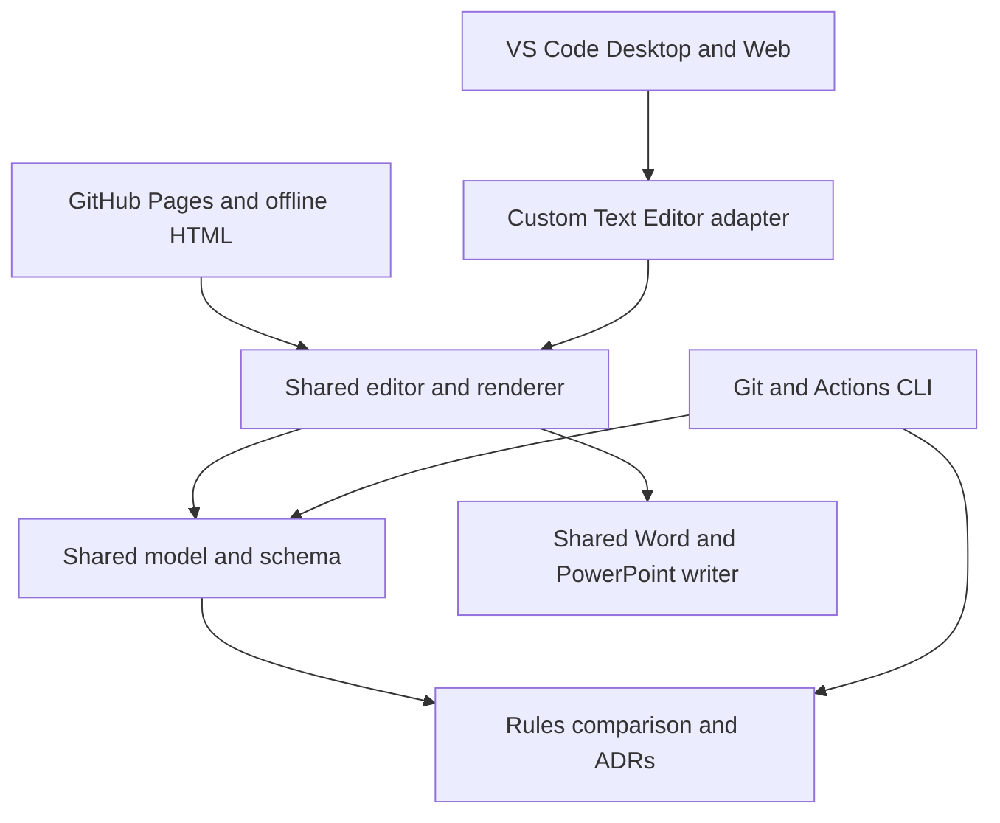

# Developer architecture

The extension embeds the exact standalone editor built from `src/index.html`; it does not implement another modeller. Browser and CommonJS bundles of `packages/index.ts` come from the same strict TypeScript sources. The retained graph, dimensions, Office writer and UI call these packages through `ModellerPlatform`.

## Environment boundaries

Domain packages contain no Node filesystem/process/native calls. The web storage adapter uses IndexedDB when instantiated, not at module import. Existing graph projection/layout is pure JavaScript. Browser Office exporters receive models and view specs and return `Uint8Array` bytes; DOCX rasterisation uses browser canvas or an explicit test adapter.

The CLI is a Node adapter for reading files, rendering readable/JSON/SARIF reports and returning exit codes. Node-only exporter QA loads bundled browser PptxGenJS in a VM; that path is never used in deployed browser assets.

The extension host bundles for `platform: browser` with `vscode` as its only external module. It imports the same schema, formats and governance as the website. File reads/writes use `workspace.fs`. The Custom Text Editor wraps a TextDocument, so VS Code handles file dirtiness, normal saving, source editing, undo/redo and virtual workspaces.

The webview posts typed operation envelopes; the host validates each mutation's size, syntax and expected document version. Text edits apply through WorkspaceEdit. Authored acknowledgements are distinguished from external changes. Conflicts block further overwrites and retain canvas JSON recovery. Export messages carry binary bytes to a native save dialog, not a browser download. Source navigation accepts only safe web URLs and traversal-free workspace paths.

A nonce is applied only to actual top-level script tags. Replacing every literal `<script` inside bundled JavaScript would corrupt string constants; a regression check and real web-host test cover this boundary.

## Build

`compile.mjs` emits the browser domain bundle, Node/CLI bundle and browser-compatible CommonJS extension host. `build.py` runs unit/integration tests, validates shared footer YAML, inlines code/assets, writes online/offline editions, and checks ZIP identity. `build-extension.py` embeds that offline HTML and bridge into a universal web-capable VSIX. Generated build directories are ignored.

Shared vendor asset hashes and source URLs live in the icon catalogue. Refreshing vendor artwork is a deliberate maintenance task. The online shared UI can update independently; the checked-in snapshot keeps offline builds reproducible. No hosted model API, SSR or cloud database is needed.

## Performance

The model is capped at 3,000 nodes/10,000 edges/5 MB, with 64 containment levels. These caps are not guarantees of unrestricted diagram usability. A Chromium benchmark exercises 500 visible nodes and 1,000 links. Large documentation pages are partitioned and generation shows progress. Export generation currently runs on the main thread; no worker-based Office writer or viewport culling is claimed. Keep large diagrams in focused views.
