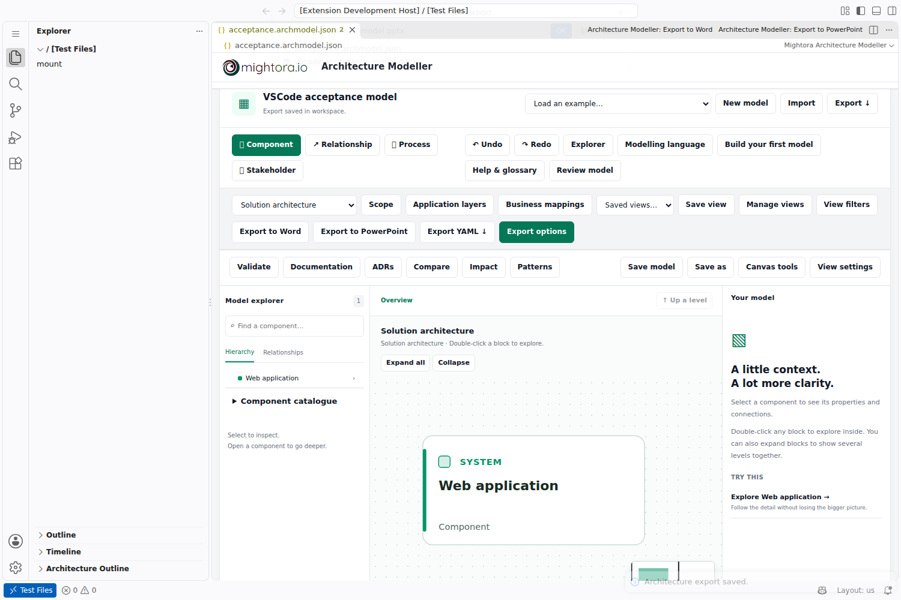

# Mightora Architecture Modeller

Create and review architecture in VS Code with the same modelling engine and Office exporters as the free [Mightora website](https://architecture-modeller.mightora.io/).

Open `.archmodel.json`, `.archmodel.yaml` or legacy `.architecture.json`/YAML files in the custom visual editor. Model nested systems and components, connect exact dependencies, map processes and stakeholders, save viewpoints, document ownership/security, record ADRs, validate and compare versions.

**Export to Word** and **Export to PowerPoint** remain available in the editor and Command Palette. Word contains editable headings/tables and vector diagrams. PowerPoint contains editable shapes, text and attached connectors; icons remain images. Files generate locally and save through VS Code's file-provider APIs.

## Commands and integration

Commands use the Architecture Modeller prefix: Create New Model, Open Visual Editor, Validate Architecture, Select Viewpoint, Export to Word, Export to PowerPoint, Generate Documentation, Compare Models, Create Architecture Decision Record and Search Components.

The Explorer Architecture Outline reveals components. Problems displays governance findings. Source links open workspace files or safe web URLs. Native saves and undo/redo operate on the underlying text file. Version checks prevent silent overwrites when another editor changes the document.

## Privacy and hosts

The embedded editor blocks outbound application connections. No account, backend, external AI or paid API is needed. Explicit external source links navigate only when selected. Files are portable between the website, offline HTML and VS Code.

The package has both `browser` and `main` entries and supports virtual workspaces. Desktop, vscode.dev, github.dev and Codespaces hosting/installation policies apply. See [test results and limitations](https://github.com/mightora/architecture-modeller.mightora.io/blob/main/docs/verification.md) for verified hosts; Marketplace publication is separate from packaging.

## Installation and publishing

Build from the repository with `npm ci && npm run build:offline`. Use VS Code's **Install from VSIX** and select the generated file. The [installation and Marketplace guide](https://github.com/mightora/architecture-modeller.mightora.io/blob/main/docs/vscode.md) explains publishing under the configured `mightoraio` publisher.

[MIT source licence](https://github.com/mightora/architecture-modeller.mightora.io/blob/main/LICENSE). Bundled vendor artwork retains its separate provider terms and does not imply endorsement.
